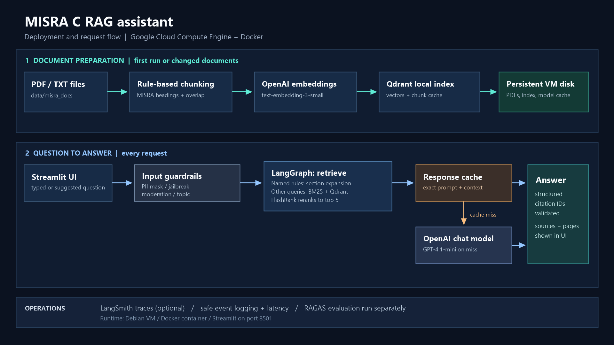

# MISRA C RAG assistant

A Streamlit assistant for questions about uploaded MISRA C references. Input guardrails screen and mask the question before LangGraph retrieves evidence and generates an answer. LangChain handles document processing and retrieval, Qdrant stores vectors, and FlashRank reranks general-search results locally. RAGAS evaluates generated answers and retrieval results separately from the live app.

## Features

- Section-aware ingestion: detects `Rule`, `Directive`, `Appendix`, and `Section` headings. Long sections are split into overlapping subchunks while retaining the section, source, and page metadata.
- Hybrid search: BM25 plus semantic Qdrant search, combined with reciprocal-rank fusion through LangChain's `EnsembleRetriever`.
- Persistent local Qdrant index: vectors are stored under `data/qdrant/` and reused across app restarts. Section chunks are cached alongside each corpus-specific index so PDFs are parsed only when the corpus changes. BM25 is rebuilt in memory from the cached section chunks.
- Persistent exact-match response cache: structured LLM answers are stored in `data/response_cache.sqlite` and reused when the model settings, full prompt, conversation history, and retrieved excerpts match. Retrieval still runs for each question.
- Local reranking: FlashRank runs a cross-encoder on the hybrid candidates and keeps the top five excerpts. Its small model files are downloaded on first use.
- Chat memory: LangGraph `MemorySaver` uses a per-conversation thread ID. The Streamlit sidebar can reopen earlier conversations during the current session; they are not stored across a server restart.
- Evidence-first answers: model instructions require citations and abstention when the indexed documents do not support an answer. The retrieved excerpts are shown in the interface.
- Input guardrails: Guardrails AI masks PII and checks prompt injection and topic relevance before retrieval or LangSmith tracing. OpenAI moderation checks the masked question for unsafe content. The Streamlit chat stores and displays the masked question.
- Structured responses: LangChain requests an `answer`, retrieved-context `citation_ids`, and an `insufficient_evidence` flag. The app removes citation IDs absent from the retrieved excerpts. This checks citation references, not whether every factual claim is correct.
- RAGAS evaluation: reports faithfulness, answer relevancy, context precision, context recall, and answer correctness against manually reviewed references.

No copyrighted MISRA standard is included. Add only documents you are authorized to use.

## System Architecture

The diagram below illustrates the MISRA C Assistant architecture,
including document processing, retrieval, guardrails, and answer generation.



## Run

Requires Python 3.10+ and an OpenAI API key. Chat, embeddings, and RAGAS judging use OpenAI; reranking runs locally.

```powershell
Set-Location 'C:\path\to\misra_c_rag'
python -m venv .venv
.venv\Scripts\Activate.ps1
python -m pip install -r requirements.txt
Copy-Item .env.example .env
# Set OPENAI_API_KEY in .env before starting the app
streamlit run app.py
```
LIVE APP (http://34.126.154.147:8501)
VIDEO DEMO (https://www.youtube.com/watch?v=H01eLvokdaw)

`requirements.txt` contains the live app dependencies and is installed when the Docker image is built on the Google Cloud VM. It installs the small English spaCy model during the build; `presidio_nlp.yaml` directs Presidio to use that model for PII screening. This replaces the large spaCy model while retaining Guardrails AI's PII masking, local jailbreak check, topic check, and OpenAI moderation. The PII validator still loads GLiNER, so test masking after deployment. The VM's `data/` directory is mounted into the container at `/app/data` to preserve documents, indexes, and caches across container restarts and image rebuilds.

Upload PDF or TXT files from the sidebar, or place them in `data/misra_docs/` before starting. PDF pages are read with PyMuPDF. TXT files are treated as extracted source text. Qdrant files are stored locally in `data/qdrant/`; corpus or embedding-model changes create a separate index version. Keep this directory to preserve the index, and back it up with the project data.

Response caching is enabled by default. The cache key includes model settings, the response schema, and the full prompt, including retrieved excerpts and recent conversation. If any of these change, the next request misses the cache. Retrieval still runs on every question; a cache hit skips only model generation. To demonstrate a hit, ask the same question in two new conversations with the same indexed documents. The `misra_answer_debug_v2` trace reports `response_cache_hit` and generation latency. Set `RESPONSE_CACHE_ENABLED=false` in `.env` and restart to disable caching. To clear saved responses, stop the app and delete `data/response_cache.sqlite`.

`input_guardrails.py` uses Guardrails AI's local `GuardrailsPII` and `DetectJailbreak` validators. The Streamlit app warms these local validators once during startup, so the first question does not pay their model-loading and first-inference cost. The warm-up uses a harmless sample question and creates no audit event or OpenAI request. `RestrictToTopic` uses `gpt-4o`, and OpenAI moderation checks unsafe content; both receive only the sanitized question and add API calls to each allowed request. Initial startup may download local models into ignored `data/model_cache/` and take longer; later questions reuse the loaded validators. A validator failure blocks the question rather than sending unscreened text to the RAG graph. Uploaded source documents and retrieved excerpts are separate inputs and are not PII-masked by this question gate.

For short questions naming a numbered rule or directive, the topic validator is given the MISRA C domain explicitly (for example, `What is rule 2.3?`). Retrieval and answer generation still receive the user's sanitized question. This prevents short valid rule questions from being rejected solely because they omit the word MISRA.

Each guardrail decision writes a JSON line to `data/guardrail_events.jsonl` with a UTC timestamp, event ID, outcome, validator name, and whether PII was masked. It does not record question text. To document a block, capture both the app response and the matching audit line (`Get-Content data/guardrail_events.jsonl -Tail 1`). The `guardrail` field identifies the validator that stopped that specific request. A prompt-injection attempt blocked by `RestrictToTopic` demonstrates topic filtering, not a `DetectJailbreak` detection. An `error_blocked` event means a validator failed and the app stopped the request as a precaution.

## RAGAS evaluation

For local evaluation, install the additional packages first:

```powershell
python -m pip install -r requirements-eval.txt
```

`requirements-eval.txt` includes the live app requirements plus RAGAS, `datasets`, and `pandas`. It is for separate evaluation runs and is not installed in the live Docker image.


The evaluation script runs the app's retrieval and answer path, then scores each case against its reference. Use the manually reviewed `evaluation_dataset.json` for the capstone's 24-case benchmark:

```powershell
python evaluate.py evaluation_dataset.json --output ragas_results.csv
```

This writes scores to `ragas_results.csv` and the generated answers and contexts to `ragas_results.samples.json`. To rerun only the RAGAS judges on those saved samples, use:

```powershell
python evaluate.py evaluation_dataset.json --samples ragas_results.samples.json --output ragas_rescored.csv
```

Score-only mode does not rerun retrieval or answer generation. Keep the dataset questions and references unchanged when reusing samples. For a reliable benchmark, include exact rule questions, paraphrases, unanswerable questions, and distinctions between adjacent requirements. Review synthetic references before using them as ground truth.

Evaluation generation disables response caching so a fresh run generates new answers. RAGAS scores can still vary between judge runs.

The local Qdrant directory can be opened by only one process at a time. Stop the Streamlit app before running a separate evaluation process that uses the same index.

## LangSmith tracing

Tracing is optional and disabled by default. To inspect retrieval, answer generation, judge calls, and their latency, set these values in your local `.env` (or use your deployment platform's secret settings):

```dotenv
LANGSMITH_TRACING=true
LANGSMITH_API_KEY=<your-langsmith-api-key>
LANGSMITH_PROJECT=misra-c-rag
LANGSMITH_INDEX_TRACING=false
LANGSMITH_INDEX_PROJECT=misra-c-rag-indexing
```

Restart the Streamlit app after changing `.env`. New app questions appear in the LangSmith project as `misra_rag_v2` graph traces tagged `app`. Run `python evaluate.py evaluation_dataset.json --output ragas_results.csv` to create one generation trace per question, tagged `evaluation-generation` with a one-based `case_index`. RAGAS judge calls are tagged `evaluation-judge` with `case_index` and `metric`. Score-only mode traces judge calls only because it reuses saved answers and contexts.

Open the project in LangSmith and filter by tag or `case_index` to inspect retrieval, answer generation, judge calls, and duration. Retrieval debug runs include the requested rule IDs, retrieval mode, BM25 candidates and scores for general questions, returned contexts, and latency. Answer debug runs include the prompt version, answer length, citation IDs, insufficient-evidence status, cache hit, and generation latency. LangSmith can receive retrieved document text and model inputs and outputs. Use tracing only with documents and questions you are permitted to send to that service. Keep the API key in `.env` or the platform's secret store; `.gitignore` excludes the local `.env` file.

Set `LANGSMITH_INDEX_TRACING=true` when you want index-build traces in the separate `misra-c-rag-indexing` project. The summary reports separate cache hits for document chunks and the Qdrant vector collection, chunk count, document loading and chunking time, embedding and Qdrant indexing time, and total index preparation time. When both caches are hit, the new chunking and embedding times are zero. The flag works independently of normal app tracing; indexing calls are excluded from the normal project when index tracing is off. Existing cached indexes do not rebuild merely because tracing is enabled.

The Streamlit server logs index setup, guardrail warm-up, and answer-generation failures using only an event ID, a fixed stage name, and the exception class. The same event ID appears in the app's error message so you can find the corresponding server log line. These app error records omit question text, answers, exception messages, tracebacks, and credentials. LangSmith tracing is separate: it can include retrieved document text and answers, so use an approved corpus when enabling it.

## Notes on section parsing

The section parser recognizes genuine headings such as `Rule 8.7` and `Directive 4.1`. Standalone cross-references such as `Rule 5.1.` and `Section 6.7.2.3.` are not treated as headings, so they cannot split a rule body under the wrong section. The chunk index schema is versioned; changing the parser creates a fresh Qdrant index automatically. If a PDF has unusual typography, multi-column extraction, or headings that do not match these patterns, inspect the retrieved evidence and adjust `_SECTION_RE` in `rag.py`; the fallback still splits the page text and labels it as an unlabelled section.

## Documentation

- [Prompt Comparison](doc/evidence/prompt/prompt.md)
- [Evidence](doc/evidence/README.md)
